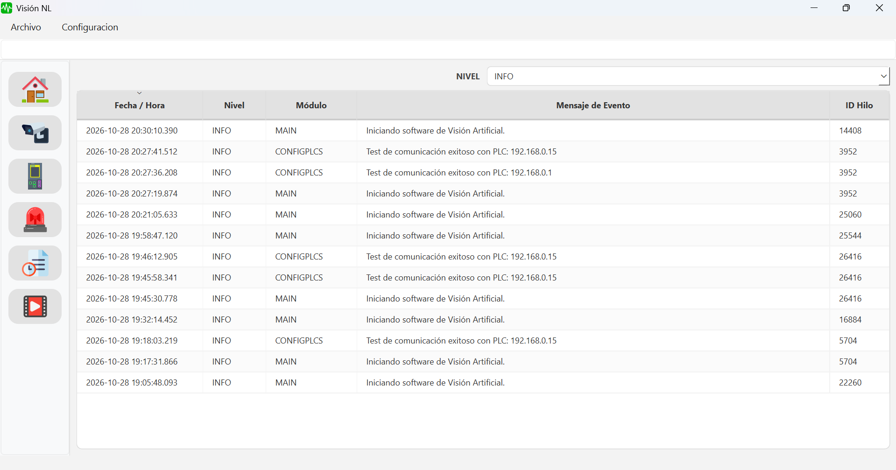
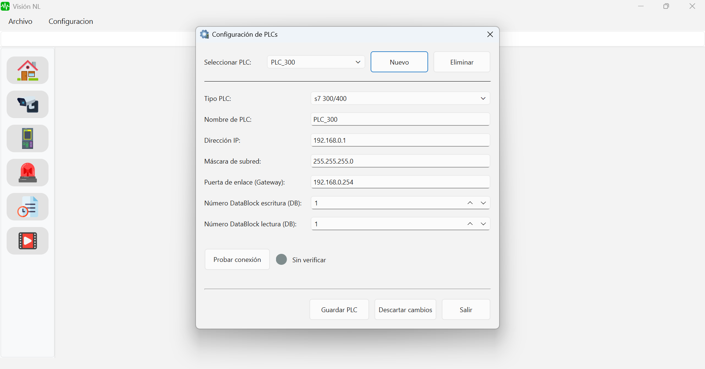
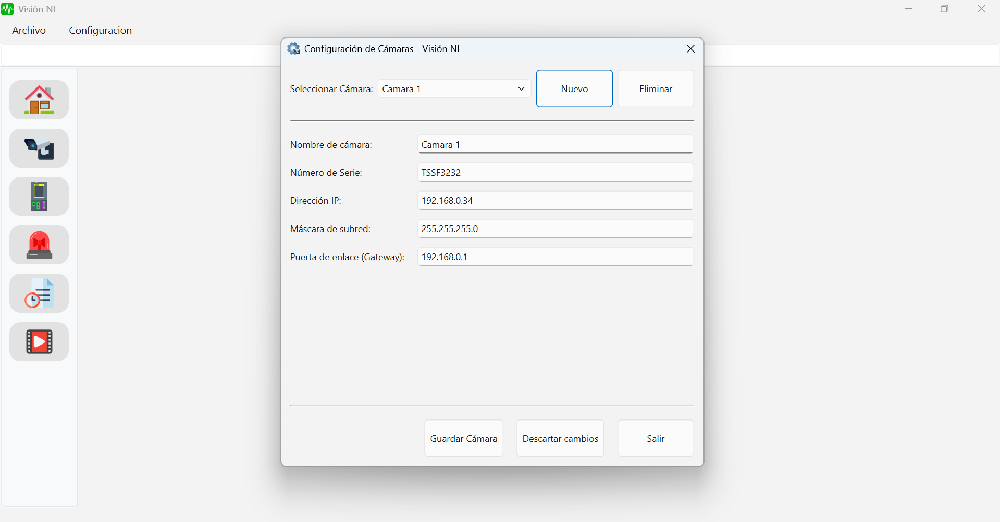
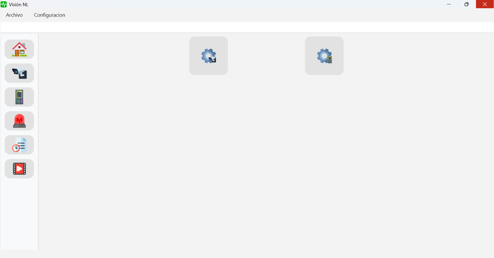
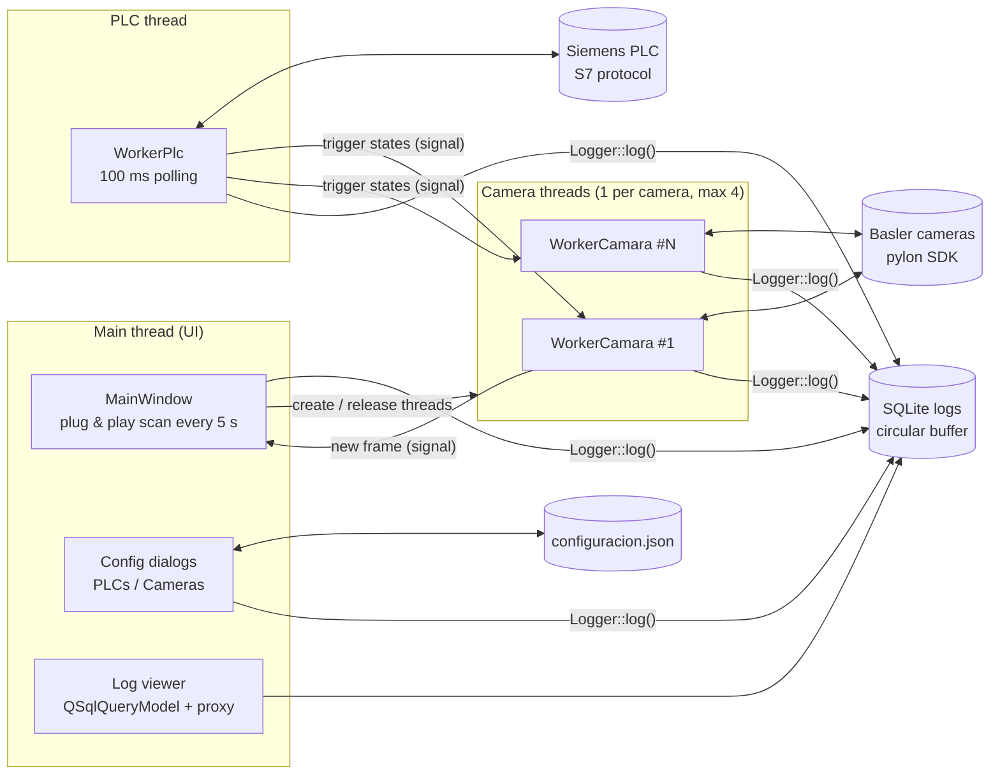

# NLvision

**Industrial machine-vision desktop application for production lines - C++17 · Qt 6 · Basler pylon · Siemens S7**

NLVision connects industrial cameras and Siemens PLCs in a single operator application. The PLC tells each camera when to acquire (hardware-style triggers over S7 communication), and every event in the system is recorded in a thread-safe SQLite log that operators can browse and filter from the UI.

> **Status:** work in progress, personal project. This repository is a showcase (overview, architecture and screenshots). The full source code is private and available on request.



---

## Screenshots

| PLC configuration | Camera configuration |
|---|---|
|  |  |

<details>
<summary>Home screen</summary>



</details>

---

## Features

**Camera management (Basler pylon SDK)**
- Plug & play detection: the bus is scanned every 5 s; cameras are identified by serial number.
- One dedicated worker thread per camera (up to 4), created when a camera is connected and released cleanly when it is unplugged.
- Acquisition loop with `GrabStrategy_LatestImageOnly` to avoid latency build-up, conversion to RGB and safe hand-off of frames to the UI thread via signals.

**PLC communication (Siemens S7-300/400 and S7-1200/1500)**
- PLC configuration dialog: type, IP/mask/gateway (validated), rack/slot and read/write data blocks.
- Connection test with live status indicator, using the S7 protocol (Snap7).
- Dedicated PLC worker thread polling at 100 ms; trigger states are emitted only on change, and each camera subscribes to its own trigger bit.

**Logging & diagnostics**
- Central logger callable from any thread: timestamp (ms), level, module, message and thread ID.
- Thread safety through a shared mutex and one SQLite connection per thread.
- Circular buffer implemented as an SQLite trigger (keeps the latest 500,000 records).
- Log viewer with level filter, column sorting and incremental loading on scroll (model / proxy / view).

**Configuration**
- PLCs and cameras persisted in a JSON file next to the executable; a default template is created on first run.

---

## Architecture



Workers are plain `QObject`s moved to their own `QThread` (`moveToThread`); all cross-thread communication goes through Qt signals and slots, and shared state is limited to atomics and the mutex-protected logger.

```
├── main.cpp            # app bootstrap: pylon init, logger, stylesheet
├── ui/                 # MainWindow: navigation, thread lifecycle, log viewer
├── dialogs/            # PLC and camera configuration dialogs
├── workers/            # WorkerPlc, WorkerCamara (one thread each)
├── storage/            # ConfigManager (JSON), Logger (SQLite)
└── styles/             # QSS theme
```

---

## Tech stack

| Area | Technology |
|---|---|
| Language / build | C++17, CMake |
| Framework | Qt 6.5+ (Widgets, SQL) |
| Cameras | Basler pylon SDK |
| PLC communication | Snap7 (Siemens S7 protocol) |
| Storage | SQLite, JSON |
| Platform | Windows (x64) |

---

## Roadmap

- [x] Multi-window UI with sidebar navigation and QSS theme
- [x] PLC and camera configuration persisted in JSON
- [x] Thread-safe SQLite logging with circular buffer and log viewer
- [x] Dynamic per-camera threads with plug & play detection
- [x] PLC connection test (S7-300/400, S7-1200/1500)
- [ ] Cyclic PLC data-block read/write in the PLC worker
- [ ] Live camera view in the UI
- [ ] Image processing pipeline (OpenCV) and writing inspection results back to the PLC
- [ ] Alarm management and video recording/playback

---

## Author

**Nicolás E. Lastra** — Mechatronics Engineer
[LinkedIn](https://www.linkedin.com/in/nicolas-e-lastra) · [GitHub](https://github.com/NicoLastra12)

Copyright © 2026 Nicolás E. Lastra. All rights reserved. This repository contains documentation only; no license is granted to use, copy or distribute the software.
